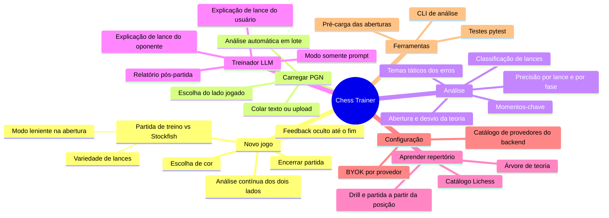

# 01 — Catálogo de features

Funcionalidades extraídas da leitura do código. Cada item indica onde está implementado e os parâmetros que governam o comportamento.

## Visão geral

---

## F1. Tela inicial

- Dois caminhos: **Novo jogo** e **Carregar PGN** ([LandingPage.tsx](../frontend/src/components/LandingPage.tsx)).
- Navegação entre telas controlada por um estado `screen` em [App.tsx](../frontend/src/App.tsx): `home → pgn-loader → color-selection → game`.

## F2. Escolha de cor

- Modal reutilizado nos dois fluxos ([ColorSelector.tsx](../frontend/src/components/ColorSelector.tsx)).
- Em **Novo jogo**: "com qual cor você quer jogar". Em **PGN importado**: "com quais peças você jogou" — define quais lances são do usuário e serão analisados no relatório.
- Tabuleiro é orientado conforme a cor escolhida.

## F3. Partida de treino contra o Stockfish

Implementado em [GameBoard.tsx](../frontend/src/components/GameBoard.tsx) (modo `training`) e [engine_service.py](../backend/services/engine_service.py) (`get_engine_move`).

- O usuário move peças por arrastar-e-soltar; `chess.js` valida o lance localmente antes de qualquer chamada ao servidor. Promoção é sempre para dama.
- Se o usuário joga de pretas, o motor faz o primeiro lance automaticamente.
- O motor responde via `POST /api/engine-move` com `training: true`, profundidade 20.
- **Modo leniente (grace)** — nos primeiros `GRACE_FULLMOVES = 12` lances, se o melhor lance do motor levaria a sua chance de vitória acima de `GRACE_WIN_CAP = 70%`, ele escolhe o candidato mais forte que fique entre `GRACE_WIN_FLOOR = 50%` e 70%. Objetivo: não punir de imediato os erros iniciais de quem está aprendendo, sem nunca entregar a partida. Quando isso acontece, o lance do usuário é marcado (`lenient_plies`) e o relatório avisa que aquele erro era real.
- **Variedade** — para não repetir sempre a mesma linha, o motor sorteia entre os candidatos (MultiPV = 3) cuja chance de vitória esteja a até 3,0 p.p. do melhor (até o lance 10) ou 1,5 p.p. (depois). Mate forçado é sempre jogado.
- **Análise contínua, feedback oculto** — cada lance, do usuário *e* do motor, é classificado em segundo plano assim que é jogado (enquanto o usuário pensa no próximo). Durante a partida não aparecem badges nem análise; o painel informa que o sistema está avaliando o nível do jogador. Tudo é revelado no fim.
- **Fim de partida** — detectado automaticamente (xeque-mate, afogamento, tripla repetição, material insuficiente, empate) ou pelo botão **Encerrar partida** (abandono).

## F4. Classificação de lances (motor)

[engine_service.py](../backend/services/engine_service.py) — `get_move_analysis` e `get_move_classification`. Exposto em `POST /api/engine-analysis`.

1. Stockfish avalia a posição **antes** e **depois** do lance (profundidade 20 cada).
2. A avaliação em centipawns, do ponto de vista de quem jogou, é convertida em probabilidade de vitória por uma sigmoide (mesma curva usada pelo Lichess):
   `Win% = 50 + 50 · (2 / (1 + e^(−0,00368208·cp)) − 1)`; mate vale ±10000 cp.
3. `delta = max(0, Win%_antes − Win%_depois)` é a perda de chance de vitória causada pelo lance.

| Classificação | Regra | Badge |
|---|---|---|
| Best Move | lance igual ao 1º lance da linha principal do Stockfish | `!` |
| Good Move | delta ≤ 5 | `★` |
| Inaccuracy | 5 < delta ≤ 12 | `?!` |
| Mistake | 12 < delta ≤ 25 | `?` |
| Blunder | delta > 25 | `??` |

Quando cada lance é classificado:

| Situação | Lances do usuário | Lances do oponente |
|---|---|---|
| Partida de treino | em segundo plano, logo após o lance | em segundo plano, logo após o lance do motor (desde `2247f0c`) |
| Fim da partida de treino | só os que falharam são reanalisados | só os que falharam são reanalisados, em paralelo com o relatório |
| PGN importado | em lote, com barra de progresso, antes do relatório | em lote, em segundo plano, depois que o relatório começa |

As classificações dos dois lados geram os badges do histórico e permitem pedir a explicação de qualquer lance.

## F5. Importação de PGN

[LoadPGNPage.tsx](../frontend/src/components/LoadPGNPage.tsx), [App.tsx](../frontend/src/App.tsx), [GameBoard.tsx](../frontend/src/components/GameBoard.tsx) (modo `review`).

- PGN colado em texto ou carregado de arquivo `.pgn`/`.txt`; validado com `chess.js` antes de avançar.
- O histórico é reconstruído lance a lance; nomes dos jogadores vêm dos cabeçalhos `White`/`Black`.
- A partida já começa no estado "encerrada": todos os lances do usuário são analisados automaticamente com **concorrência 2** e barra de progresso ("Analisando seus lances: X de Y"), depois o relatório é gerado (`imported: true`), e em paralelo os lances do oponente são classificados.

## F6. Relatório pós-partida

Cálculo em [report_service.py](../backend/services/report_service.py) e [openings_service.py](../backend/services/openings_service.py); exibição em [GameReport.tsx](../frontend/src/components/GameReport.tsx).

Exige pelo menos 3 lances analisados do usuário. Desde o commit `2ab6da0`, é dividido em **duas requisições sequenciais**, para que as estatísticas apareçam na tela sem esperar a LLM:

1. `POST /api/game-stats` — parte determinística, rápida, sem LLM. Assim que responde, a tela mostra estatísticas e badges.
2. `POST /api/game-report` — recebe as estatísticas já calculadas e devolve só a narrativa do treinador. O botão **Gerar novamente** reenvia apenas esta requisição.

**a) Estatísticas determinísticas (`/api/game-stats`)**

| Métrica | Como é calculada |
|---|---|
| Precisão por lance | Fórmula do Lichess: `103,1668·e^(−0,04354·delta) − 3,1669`, limitada a [0, 100] |
| Precisão média | Média das precisões dos lances analisados |
| Contagem por classificação | Best / Good / Inaccuracy / Mistake / Blunder |
| Fase do jogo | `endgame` se material não-peão total ≤ 26; `opening` até o lance 10; senão `middlegame` |
| Estatísticas por fase | Lances, precisão e erros em abertura, meio-jogo e final |
| Temas táticos dos erros | `hung_piece`, `missed_capture`, `missed_check`, `missed_mate`, `allowed_mate`, `walked_into_tactic` — calculados com `python-chess` a partir das posições e da linha do Stockfish |
| Momentos-chave | Os 3 erros com maior perda de Win%, com FEN, melhor lance, linha ideal e refutação |
| Abertura | ECO + nome, linha de referência, lances dentro da teoria, onde e por quem a partida saiu da teoria e quais lances teóricos existiam |

**b) Narrativa do treinador (`/api/game-report`, LLM)** em 6 seções fixas: avaliação geral (faixa de nível, sem Elo), abertura e teoria (com recomendações de estudo), pontos fortes, pontos a melhorar (citando lances), orientações de treino e explicação dos momentos-chave. O prompt proíbe inventar lances fora dos dados.

Se a LLM falhar ou não estiver configurada, `/api/game-report` responde com erro HTTP (400 sem configuração, 502 erro do provedor), as estatísticas já exibidas continuam na tela e o painel oferece **Configurar LLM** e **Gerar novamente**.

Os momentos-chave são clicáveis e levam o tabuleiro para a posição anterior ao erro.

## F7. Explicação de lance pelo treinador

Endpoint `POST /api/move-evaluation`; prompt em `generate_prompt` ([llm_service.py](../backend/services/llm_service.py)).

- Disponível após o fim da partida, no painel **Análise por lance**.
- O usuário seleciona qualquer lance no histórico (seu ou do oponente) e pede a explicação.
- O prompt inclui FEN antes/depois, melhor lance, avaliação, profundidade, linha principal, classificação e delta.
- Muda conforme quem jogou (`mover`):
  - `user`: compara o lance jogado com o melhor lance.
  - `opponent`: explica a ideia do oponente e diz como o usuário pode punir o erro ou se defender da ameaça.

## F8. Navegação no histórico (modo revisão)

- Clicar em qualquer lance mostra a posição correspondente; botão para voltar à posição atual/final.
- Lance selecionado fica destacado e o painel do treinador rola até a análise por lance.

## F9. Configuração de LLM (BYOK — *bring your own key*)

[LLMSettings.tsx](../frontend/src/components/LLMSettings.tsx), [llmConfig.ts](../frontend/src/llmConfig.ts), `GET /api/llm-providers`.

- O backend publica o catálogo de provedores e seus padrões; o frontend monta o formulário a partir dele.
- Provedores: **Gemini** (`gemini-2.5-flash`, exige chave) e **Somente prompt**. Qualquer outro provedor compatível com a API da OpenAI (ex.: Ollama local) entra com uma nova entrada em `PROVIDER_DEFAULTS`.
- Modelo e URL em branco usam o padrão do provedor.
- A configuração fica em `sessionStorage` (sobrevive a recarregar a página, some ao fechar a aba) e é enviada a cada requisição; o servidor nunca armazena nem lê chaves do ambiente.

## F10. Modo "Somente prompt"

Provedor `prompt`: nenhuma LLM é chamada e a resposta é o prompt completo (system + user) em um bloco de código. Útil para depurar e calibrar os prompts e para usar sem chave.

## F11. CLI de análise

[chess_trainer_system_cli.py](../backend/chess_trainer_system_cli.py)

- `--mode interactive`: pede FEN e lance UCI no terminal.
- `--mode files`: processa todos os `.json` (`{"fen", "move"}`) de `backend/inputs/` e grava em `backend/output/`.
- Sobe o servidor FastAPI automaticamente se estiver offline e consome `/engine-analysis` + `/move-evaluation` (sem enviar configuração de LLM, portanto cai no provedor padrão sem chave).

## F12. Pré-carga da base de aberturas

Indexar `openings.tsv` leva ~5 s. Desde `5ceeb35`, o servidor faz isso em uma *thread* de fundo ao iniciar (`lifespan` do FastAPI), protegida por *lock*: uma requisição que chegue durante a indexação espera por ela em vez de indexar uma segunda cópia. Antes, o custo caía no primeiro relatório após cada reinício.

## F13. Localização do Stockfish

`find_stockfish` procura, nesta ordem: variável `STOCKFISH_PATH` → binários dentro de `backend/stockfish/` → `/usr/games/stockfish` → `stockfish` no `PATH`.

## F15. Aprender repertório *(em desenvolvimento)*

Novo modo de jogo para estudar uma abertura ou defesa do catálogo Lichess: drill das linhas teóricas no tabuleiro e, ao fim da linha (ou se o jogador confirmar que quer sair da teoria), partida contra o Stockfish a partir da posição. Plano completo e status por fase em [07-modo-repertorio.md](07-modo-repertorio.md).

Já funciona no navegador: escolha da abertura e da cor, drill das linhas com dica e seta, confirmação ao sair da teoria (com a avaliação do Stockfish), partida contra o Stockfish depois da teoria com a precisão dos lances fora dela, e resumo da sessão. Falta a LLM (apresentação da abertura e "por que esse lance?").

Backend (Fase 1, commit `a719b4c`), em [repertoire_service.py](../backend/services/repertoire_service.py):

- **Catálogo** (`GET /api/repertoire/catalog`): 150 famílias e 1.306 variantes, agrupadas pelo nome do dataset (`Família: Variante, Subvariante`). Cada item traz ECO, linha de referência, número de linhas e a **cor sugerida**: o lado que joga o lance que define a família (Siciliana → pretas, Ruy Lopez → brancas); variantes herdam a cor da família.
- **Árvore de teoria** (`GET /api/repertoire/tree?name=...`): todas as linhas da abertura (incluindo subvariantes) fundidas numa árvore de lances a partir da posição inicial. Cada nó tem SAN, UCI, FEN, ply, popularidade (quantas linhas do dataset passam pela posição) e o nome da linha que termina ali; filhos ordenados do mais popular ao menos popular; nó sem filhos = fim da linha. Ex.: Najdorf = 33 linhas, 86 nós, 16 KB; Siciliana inteira = 400 linhas, 900 nós, 174 KB.

## F14. Testes automatizados

[test_training_game.py](../backend/tests/test_training_game.py) (pytest) cobre: limites da precisão, detecção de fase, temas táticos, estatísticas e prompt do relatório, modo leniente, variedade de lances, identificação de abertura, prompt de lance do oponente e os endpoints `/game-stats` (estatísticas, abertura, 400 sem lances) e `/game-report` (modo somente prompt, 400 sem chave, 400 com estatísticas incompletas). [test_repertoire.py](../backend/tests/test_repertoire.py) cobre o catálogo (cores sugeridas, variantes), a árvore (linha da Najdorf, ordem por popularidade, folhas nomeadas) e os endpoints de repertório (incluindo 404). A maioria usa análises sintéticas (sem motor); os que precisam do Stockfish real são marcados com `@needs_stockfish` e pulados quando ele não está instalado.
