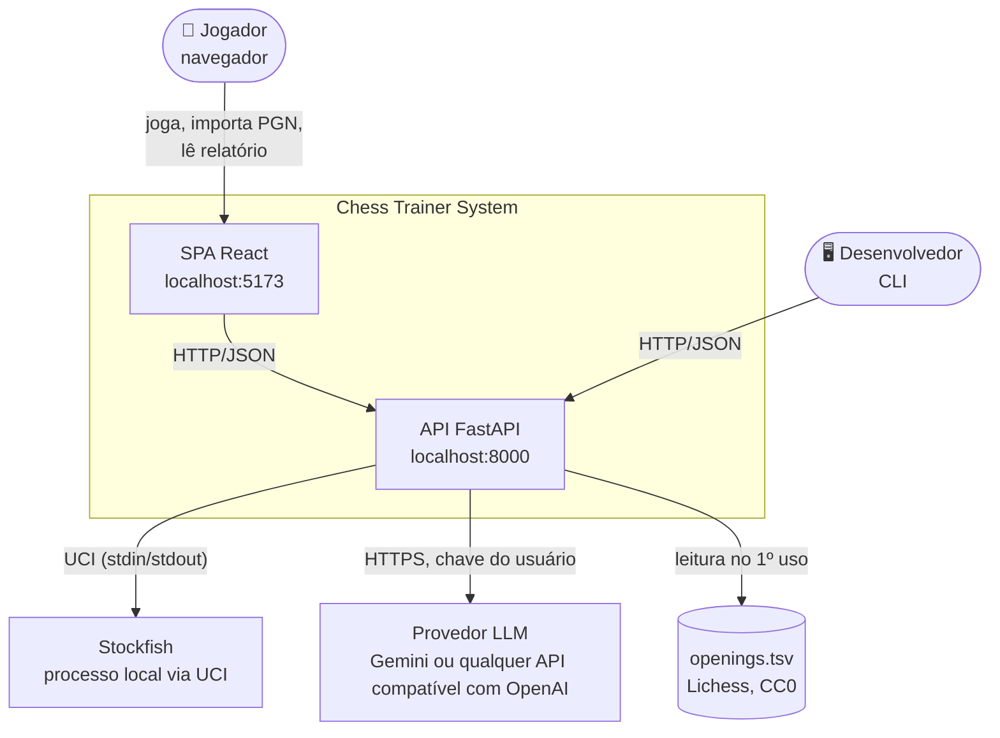
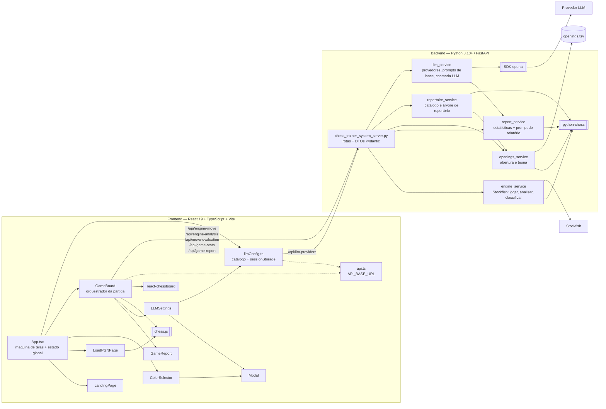
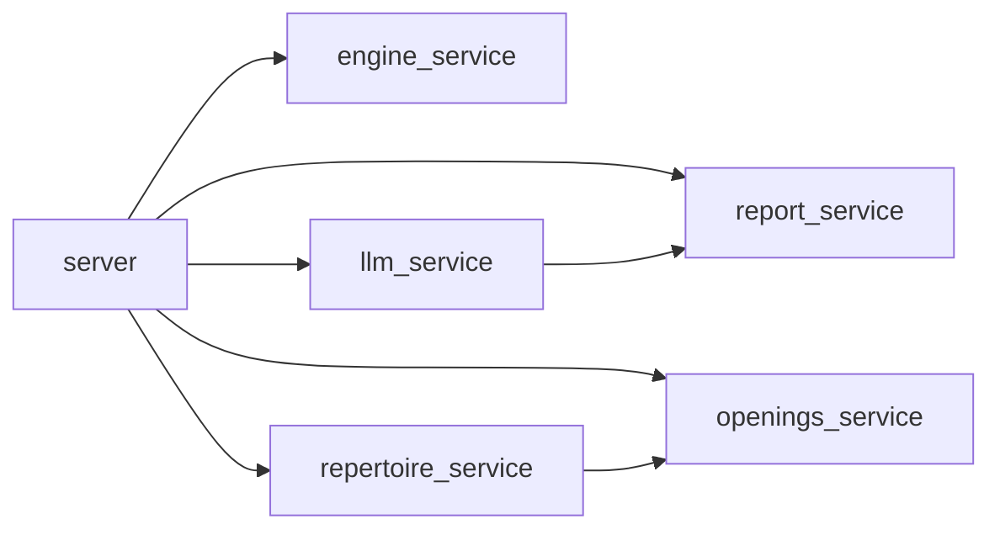
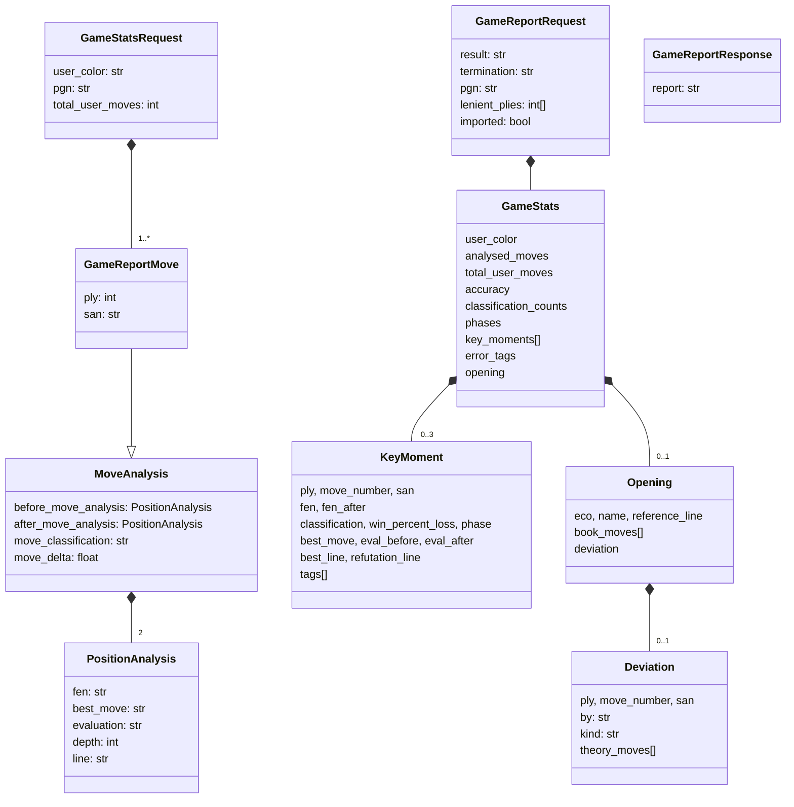
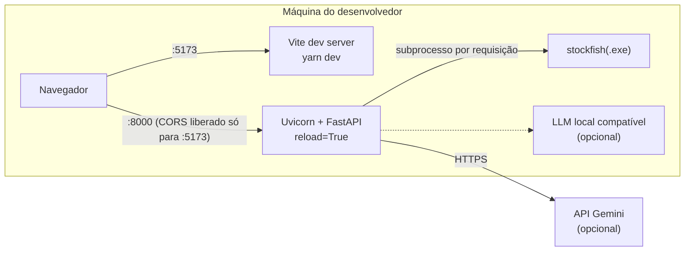

# 02 — Arquitetura

Descrição em níveis, no estilo do [modelo C4](https://c4model.com/): contexto → containers → componentes → contratos e dados.

## 2.1 Contexto

- Tudo roda localmente; o único serviço externo é o provedor de LLM (ou nem isso, com "Somente prompt" ou um provedor local compatível).
- **Backend sem estado**: não há banco de dados nem sessão. O estado da partida, as análises acumuladas e a configuração da LLM vivem no navegador e viajam em cada requisição.

## 2.2 Containers e componentes

### Frontend

| Componente | Responsabilidade |
|---|---|
| [App.tsx](../frontend/src/App.tsx) | Máquina de telas (`home`, `pgn-loader`, `color-selection`, `game`); guarda cor, partida inicial, modo (`training`/`review`) e `llmConfig`; reconstrói o histórico de um PGN |
| [LandingPage.tsx](../frontend/src/components/LandingPage.tsx) | Tela inicial com os dois pontos de entrada |
| [LoadPGNPage.tsx](../frontend/src/components/LoadPGNPage.tsx) | Entrada de PGN (texto ou arquivo) e validação com `chess.js` |
| [ColorSelector.tsx](../frontend/src/components/ColorSelector.tsx) | Escolha de lado, texto adaptado ao fluxo |
| [GameBoard.tsx](../frontend/src/components/GameBoard.tsx) | **Núcleo da aplicação** (~960 linhas): tabuleiro, turnos, chamadas ao motor, classificação em segundo plano dos dois lados, fila de análise do PGN, requisições de estatísticas e de narrativa, análise por lance, modo revisão |
| [GameReport.tsx](../frontend/src/components/GameReport.tsx) | Apresentação do relatório em dois estados independentes: `stats` (precisão, abertura, contagens, tabela por fase, momentos-chave) e `coach: CoachReport` (`text`, `error`, `loading` da narrativa) |
| [LLMSettings.tsx](../frontend/src/components/LLMSettings.tsx) | Formulário BYOK montado a partir do catálogo do backend |
| [Modal.tsx](../frontend/src/components/Modal.tsx) | Moldura de modal reutilizável |
| [llmConfig.ts](../frontend/src/llmConfig.ts) | Tipos de configuração, busca do catálogo, persistência em `sessionStorage` |
| [api.ts](../frontend/src/api.ts) | Apenas a constante `API_BASE_URL` |
| [HomePage.tsx](../frontend/src/components/HomePage.tsx) | Não é importado em lugar nenhum (código morto, versão antiga da tela inicial) |

### Backend

| Módulo | Responsabilidade | Depende de |
|---|---|---|
| [chess_trainer_system_server.py](../backend/chess_trainer_system_server.py) | App FastAPI, `lifespan` que dispara a pré-carga das aberturas em *thread*, CORS, DTOs Pydantic, 6 rotas, conversão de exceções em status HTTP | todos os serviços |
| [engine_service.py](../backend/services/engine_service.py) | Localizar o Stockfish, validar FEN/UCI, escolher lance do motor (normal, leniente, variado), analisar antes/depois, converter cp → Win%, classificar | `python-chess`, Stockfish |
| [report_service.py](../backend/services/report_service.py) | Funções puras: precisão, fase, temas táticos, estatísticas da partida, momentos-chave, prompt do relatório | `python-chess` |
| [openings_service.py](../backend/services/openings_service.py) | Indexar `openings.tsv` uma única vez (`load_openings`: cache global + `threading.Lock`; `build_openings_index` faz o trabalho) num `OpeningsIndex(named, book, lines)` — posições finais nomeadas, contador de popularidade por posição e as linhas já parseadas (`OpeningLine`); identificar abertura, ponto de desvio e lances teóricos | `python-chess`, TSV |
| [repertoire_service.py](../backend/services/repertoire_service.py) | Modo repertório: catálogo família → variante com cor sugerida (`list_repertoire_catalog`) e árvore de teoria de uma abertura (`build_repertoire_tree`); `UnknownOpeningError` para nomes inexistentes | `openings_service`, `python-chess` |
| [llm_service.py](../backend/services/llm_service.py) | Catálogo de provedores, cliente OpenAI-compatível, modo somente prompt, prompt de avaliação de lance, fachadas `generate_move_evaluation` / `generate_game_report` | `openai`, `report_service` |
| [chess_trainer_system_cli.py](../backend/chess_trainer_system_cli.py) | Cliente de linha de comando da API | `requests` |

Grafo de dependências entre módulos do backend (não há ciclos):

## 2.3 API REST

Base: `http://localhost:8000/api`. Documentação interativa em `http://localhost:8000/docs`.

| Método e rota | Entrada | Saída | Erros | Custo |
|---|---|---|---|---|
| `POST /engine-move` | `fen`, `training` | `engine_move` (UCI), `grace_applied` | 400 FEN inválida / jogo terminado; 500 motor | 1 busca prof. 20 (MultiPV 3 em treino) |
| `POST /engine-analysis` | `fen`, `move` (UCI) | `before_move_analysis`, `after_move_analysis`, `move_classification`, `move_delta` | 400 FEN/lance inválido ou motor ausente; 500 | 2 buscas prof. 20 |
| `GET /llm-providers` | — | `default_provider`, `providers{label, model, base_url, requires_api_key, uses_llm}` | — | nenhum |
| `POST /move-evaluation` | `move_analysis` (saída do `/engine-analysis`), `mover` (`user`/`opponent`), BYOK | `evaluation` (Markdown) | 400 LLM não configurada; 502 erro do provedor; 500 config | 1 chamada LLM |
| `POST /game-stats` | `user_color`, `pgn`, `moves[]` (`GameReportMove`), `total_user_moves` | `stats` | 400 sem lances ou dados inválidos | só CPU local (sem motor, sem LLM) |
| `POST /game-report` | `stats` (saída do `/game-stats`), `result`, `termination`, `pgn`, `lenient_plies`, `imported`, BYOK | `report` (Markdown) | 400 `stats` incompleto ou LLM não configurada; 502 erro do provedor; 500 config | 1 chamada LLM |

| `GET /repertoire/catalog` | — | `families[]` (`name`, `eco`, `reference_line`, `lines`, `default_color`, `variations[]`) | — | CPU local (índice já em memória); ~220 KB |
| `GET /repertoire/tree?name=` | nome de família ou variante, exatamente como no catálogo | `name`, `eco`, `reference_line`, `lines`, `tree` (nó recursivo) | 404 nome desconhecido | CPU local; 6–70 ms |

BYOK = `provider`, `api_key`, `model`, `base_url` (opcionais; vazios usam o padrão do provedor).

Nó da árvore de repertório (`RepertoireNode`): `san`, `uci` (ambos `null` na raiz), `fen`, `ply`, `popularity`, `opening` (`{eco, name}` se uma linha da abertura termina ali, senão `null`) e `children` (mais populares primeiro; vazio no fim da linha).

Observações:

- Nenhum endpoint de relatório **reanalisa** posições no motor: `/game-stats` recebe as análises que o frontend já acumulou durante a partida. Isso mantém o endpoint rápido, mas torna o frontend responsável por guardar e reenviar esses dados.
- `/game-report` recebe de volta as estatísticas que o próprio servidor calculou. Como o backend não guarda estado, ele confia no que o cliente reenvia (não há assinatura nem revalidação além de checar as chaves usadas no prompt).
- `/game-report` e `/move-evaluation` têm a mesma política de erros (400/502/500).

## 2.4 Modelo de dados

Formatos dos campos de `PositionAnalysis` (gerados por `stringfy_engine_analysis`):

| Campo | Exemplo | Observação |
|---|---|---|
| `best_move` | `e2e4 (e4)` | UCI + SAN; o `report_service` extrai a parte UCI com regex |
| `evaluation` | `+0.35 pawns`, `Mate in -3 moves` | Sempre do ponto de vista das brancas |
| `line` | `1. e4 e5 2. Nf3 ...` | Linha principal em SAN, até 30 meios-lances |
| `move_delta` | `18.42` | Perda de Win% do jogador que moveu |
| `Deviation.by` | `user`, `opponent` | Quem saiu da teoria |
| `Deviation.kind` | `left_theory`, `end_of_theory` | Saiu de uma linha conhecida, ou a base simplesmente acabou |

No frontend, o histórico é uma lista de `MoveRow { turnNumber, white: MoveDetail, black?: MoveDetail }`, em que `MoveDetail` guarda SAN, FEN e (após a análise) classificação, delta e as duas `PositionAnalysis`. Em paralelo, um `Map<ply, MoveAnalysis>` em `useRef` acumula as análises (dos dois lados) no formato exato do `/game-stats`; só as do usuário são enviadas. Depois das estatísticas, um `ReportContext` (`stats`, `result`, `termination`, `pgn`, `lenient_plies`, `imported`) fica guardado em `useRef` para permitir reenviar só a narrativa.

## 2.5 Implantação (desenvolvimento)

- Cada requisição ao motor abre e fecha um processo do Stockfish (`with SimpleEngine.popen_uci(...)`). É simples e isolado, mas paga o custo de inicialização a cada chamada.
- O FastAPI usa rotas síncronas (`def`), executadas no pool de threads; por isso duas análises paralelas do frontend realmente rodam em paralelo.
- Durante uma partida de treino, até 3 processos do Stockfish podem rodar ao mesmo tempo: a resposta do motor, a análise do lance do usuário e a análise do lance anterior do motor.
- Na inicialização, uma *thread daemon* (`openings-preload`) indexa `openings.tsv` (~5 s) sem atrasar a subida do servidor.
