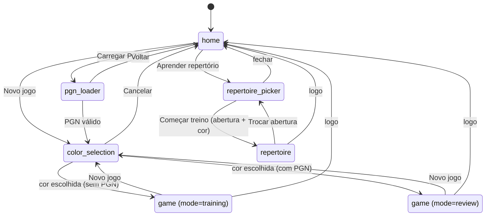
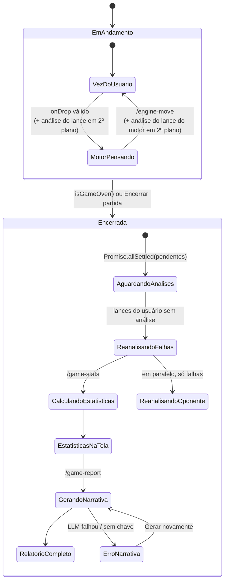
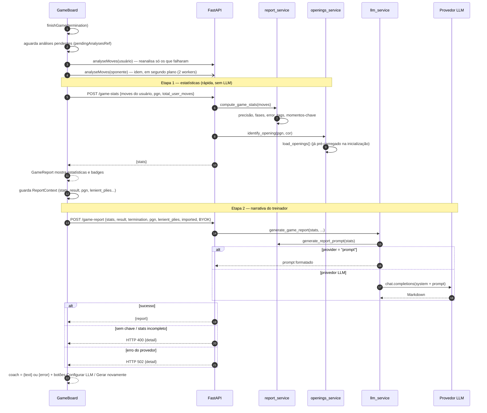
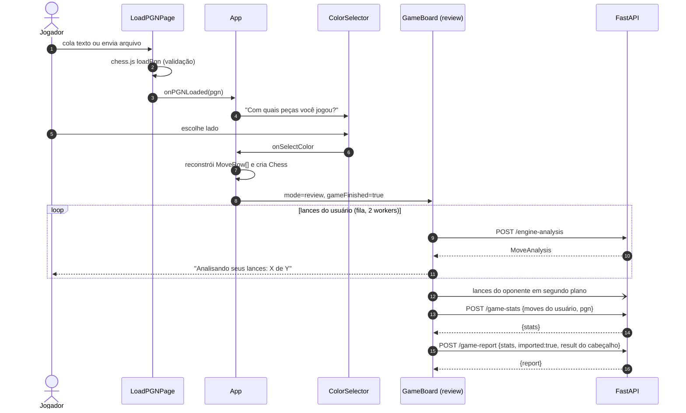
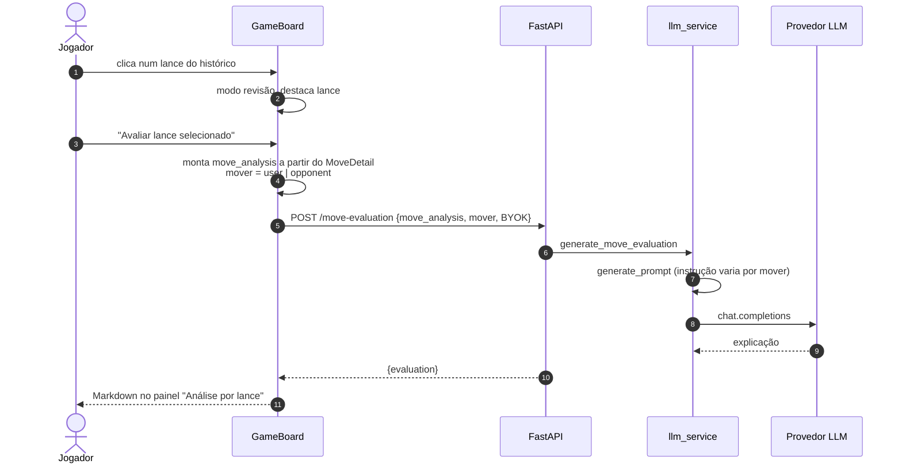
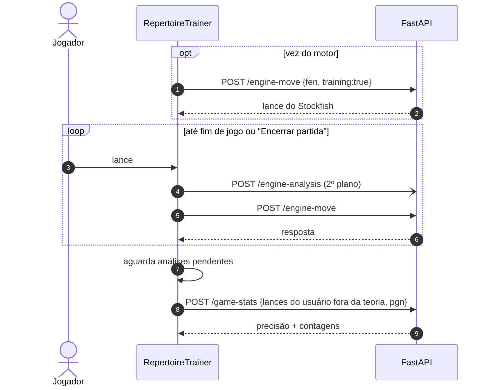
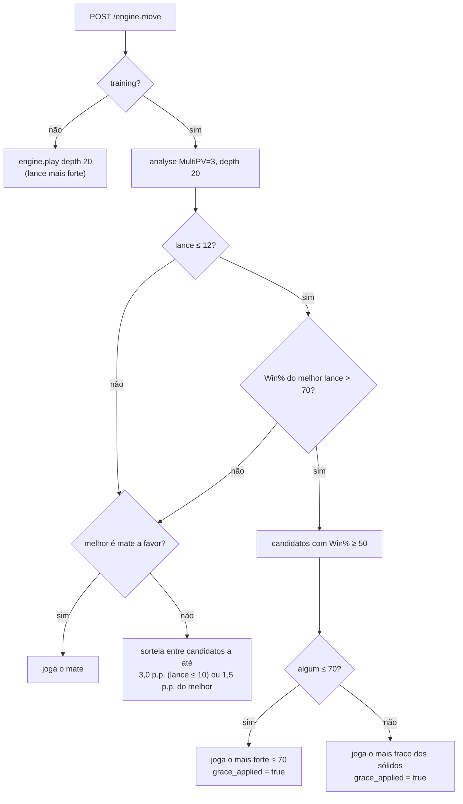

# 03 — Fluxos

## 3.1 Navegação entre telas



## 3.2 Ciclo de vida da partida de treino



Depois de encerrada, a partida aceita navegação no histórico e pedidos de explicação de lance (seção 3.6) a qualquer momento.

## 3.3 Novo jogo: um lance do usuário

Duas requisições independentes partem a cada lance do usuário: a resposta do motor (bloqueia o turno) e a classificação (segundo plano, não aparece na tela até o fim). Quando o lance do motor chega, ele também é classificado em segundo plano. As promessas pendentes ficam em `pendingAnalysesRef` (`analyseInBackground`) para o fim da partida esperar por elas.

```mermaid
sequenceDiagram
    autonumber
    actor U as Jogador
    participant GB as GameBoard
    participant API as FastAPI
    participant ES as engine_service
    participant SF as Stockfish

    U->>GB: arrasta peça (onDrop)
    GB->>GB: chess.js valida e aplica lance
    GB->>GB: recordMove (histórico)

    par Resposta do motor
        GB->>API: POST /engine-move {fen depois, training:true}
        API->>ES: get_engine_move
        ES->>SF: analyse(MultiPV=3, depth=20)
        SF-->>ES: 3 candidatos
        alt lance ≤ 12 e melhor lance > 70% Win%
            ES->>ES: choose_lenient_move (grace)
        else
            ES->>ES: choose_varied_move (sorteio entre quase-iguais)
        end
        ES-->>API: (uci, grace_applied)
        API-->>GB: {engine_move, grace_applied}
        GB->>GB: aplica lance; se grace, guarda ply em lenient_plies
        GB-->>U: tabuleiro atualizado
        GB-)API: POST /engine-analysis (lance do motor, 2º plano)
    and Classificação em segundo plano
        GB->>API: POST /engine-analysis {fen antes, move}
        API->>ES: get_move_analysis
        ES->>SF: analyse(posição antes)
        ES->>SF: analyse(posição depois)
        ES->>ES: cp → Win% → delta → classificação
        API-->>GB: MoveAnalysis
        GB->>GB: guarda em analysisByPly e no histórico (badge oculto)
    end
```

## 3.4 Fim da partida e relatório



"Gerar novamente" reenvia apenas a etapa 2 a partir do `ReportContext` guardado; as estatísticas não são recalculadas.

## 3.5 Carregar PGN



## 3.6 Explicação de um lance



## 3.7 Drill de repertório: lance do usuário

Tudo roda no navegador sobre a árvore carregada uma vez (`GET /api/repertoire/tree`); o backend só é chamado para avaliar um lance fora da teoria.

```mermaid
sequenceDiagram
    autonumber
    actor U as Jogador
    participant RT as RepertoireTrainer
    participant D as drill.ts
    participant API as FastAPI

    RT->>D: pickOpponentMove(nó, linhas concluídas)
    D-->>RT: resposta teórica (ponderada, prioriza linhas novas)
    U->>RT: arrasta peça
    RT->>D: classifyUserMove(nó, uci)
    alt lance teórico
        D-->>RT: theory + nó filho
        RT->>RT: avança; se fim de linha → line-complete
    else fora da teoria
        D-->>RT: off-book
        RT-->>U: modal "Sair da teoria?" + lances teóricos
        RT-)API: POST /engine-analysis (avaliação do lance)
        API-->>RT: classificação e avaliações
        alt Não
            U->>RT: seguir a teoria
            RT->>RT: desfaz, registra erro, dica (peça) → seta (lance)
        else Sim
            U->>RT: sair da teoria
            RT->>RT: mantém lance, registra desvio → playout
        end
    end
```

Depois da teoria (Sim no modal ou "Jogar a partir daqui" no fim da linha), a partida continua contra o Stockfish:



## 3.8 Decisão do lance do motor



> Detalhe: se o lance leniente escolhido coincidir com o melhor, `grace_applied` fica `false` e o fluxo segue para a variedade.
