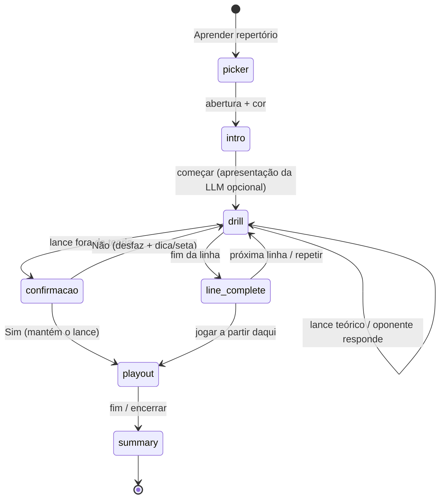

# 07 — Modo "Aprender repertório" (em desenvolvimento)

Plano aprovado e status da feature na branch `feat/learn-repertoire`. Atualize a tabela de status a cada fase concluída.

## Status

| Fase | Escopo | Status | Commit |
|---|---|---|---|
| 1 | Backend: catálogo e árvore de teoria | ✅ concluída | `a719b4c` |
| 2 | Frontend: botão na tela inicial, escolha do repertório, cliente de API tipado | ✅ concluída | `49cd306` |
| 3 | Drill no frontend (inclui confirmação ao sair da teoria) | ✅ concluída | `c86cf8e` |
| 4 | LLM: apresentação da abertura e "por que esse lance?" | ⏳ próxima | — |
| 5 | Partida contra o Stockfish a partir da posição (playout) | ✅ concluída (adiantada) | `7bcd979` |
| 6 | Documentação final | pendente | — |

## Objetivo e decisões de produto

- **Fonte do repertório:** catálogo Lichess (`backend/data/openings.tsv`). Repertório próprio via PGN fica para depois.
- **Mecânica:** drill de linhas (o sistema joga as respostas teóricas, o jogador acerta os lances do repertório) e, ao fim da linha, partida contra o Stockfish a partir da posição.
- **Saída da teoria:** quando o jogador faz um lance fora da teoria, o sistema **pergunta primeiro** se o jogador quer sair da teoria. Sim → o lance é mantido e começa a partida contra o Stockfish dali. Não → o lance é desfeito e o sistema orienta como se manter na teoria (dica com destaque da peça; depois, seta com o lance principal).
- **Progresso:** sem persistência no MVP; o estado vale só para a sessão.
- **LLM:** apresenta a abertura antes do treino e explica qualquer lance da linha ("por que esse lance?"). Prompts novos em **português**.
- **Invariantes mantidas:** a teoria define o lance certo, o Stockfish dá os números, a LLM só explica; backend sem estado.

## Arquitetura

O backend entrega a árvore de teoria inteira numa requisição; o drill roda 100% no frontend (validar lance, escolher a resposta do oponente, detectar fim de linha). O backend só volta a ser chamado para LLM, avaliação do Stockfish e a fase de jogo.

## Fases

### Fase 1 — Backend: catálogo e árvore ✅

Ver [01-features.md F15](01-features.md) e a tabela da API em [02-arquitetura.md](02-arquitetura.md). Arquivos: `backend/services/repertoire_service.py`, `backend/services/openings_service.py` (índice com `lines`), rotas em `chess_trainer_system_server.py`, `backend/tests/test_repertoire.py`.

Diferenças em relação ao plano original: a lógica ficou num módulo próprio (`repertoire_service`) em vez de dentro do `openings_service`; a árvore é `GET /api/repertoire/tree?name=` sem `color` (a cor não muda a árvore, e o frontend decide o lado).

### Fase 2 — Frontend: entrada e escolha ✅

- `LandingPage.tsx`: terceiro botão **Aprender repertório**.
- `App.tsx`: telas `repertoire-picker` e `repertoire` na máquina de estados `screen`; estado `repertoire: RepertoireSelection` (`opening` + `color`). O `RepertoireTrainer` recebe `key` = nome + cor, então trocar a seleção reinicia a sessão.
- `RepertoirePicker.tsx`: busca por nome ou ECO, sem diferenciar acentos (`Grunfeld` acha `Grünfeld`). Famílias se expandem em variantes; durante a busca, as variantes que casam aparecem já abertas. Mostra a prévia do tabuleiro no fim da linha de referência, orientado pela cor, e a escolha de cor com a sugestão marcada. Estilos `.repertoire-*` em `index.css`, com layout de uma coluna abaixo de 780 px.
- `frontend/src/repertoire/api.ts`: cliente tipado (`fetchRepertoireCatalog`, `fetchRepertoireTree`) com tipos espelhando os DTOs do backend; propaga o `detail` dos erros HTTP.
- `RepertoireTrainer.tsx`: **por enquanto só carrega a árvore** e mostra o tabuleiro inicial e um resumo (linhas e lances). A Fase 3 constrói o drill nesta tela.

Diferença em relação ao plano original: o cliente de API ficou em `frontend/src/repertoire/api.ts` (pasta da feature, junto do futuro `drill.ts`), e não em `frontend/src/api/repertoire.ts`, para não criar uma pasta `api/` ao lado do arquivo `api.ts`.

### Fase 3 — Drill ✅

**Como ficou implementado** (commit `c86cf8e`):

- [drill.ts](../frontend/src/repertoire/drill.ts), só com funções puras:
  - `classifyUserMove`, `expectedMoves`, `isUserTurn`, `sideToMove`, `isLineEnd`;
  - `pickOpponentMove(node, key, completed, forcedUci, rng)`: sorteio ponderado por popularidade, só entre filhos com linhas ainda não concluídas na sessão (cobertura), ou o lance forçado ao repetir uma linha;
  - `hintMove`: o lance mais popular entre os que levam a linhas não vistas;
  - `leafKeys`, `countLines`, `isExhausted`, `deepestOpening`, `pathKey` (um nó é identificado pelos UCIs desde a raiz).
- [RepertoireTrainer.tsx](../frontend/src/components/RepertoireTrainer.tsx), fases `drill → line-complete → playout → summary`, layout em 3 colunas reaproveitando as classes do `GameBoard`. A fase `intro` fica para a Fase 4, junto com a apresentação da LLM.
  - **Drill**: o oponente responde após 450 ms. O painel diz quantos lances teóricos existem na posição. "Mostrar dica" e "Mostrar o lance" dão a mesma ajuda que um erro, e contam como não-acerto de primeira.
  - **Fora da teoria**: o lance fica no tabuleiro e um modal mostra os lances teóricos e a avaliação do Stockfish (`/api/engine-analysis`, carregada em paralelo; respostas atrasadas são descartadas por id). **Não** desfaz o lance, registra o erro e mostra a dica (1ª vez: destaque da peça; depois: seta). **Sim** mantém o lance, registra o desvio e vai para `playout`.
  - **Fim de linha**: próxima linha, repetir (o oponente reproduz os mesmos lances) ou jogar a partir dali.
  - **Resumo**: taxa de acertos de primeira, linhas concluídas e diferentes, até 5 posições com mais erros/dicas (com os lances teóricos) e o ponto de saída da teoria.
  - `playout` saiu deste commit como provisório (só uma mensagem, com o tabuleiro travado). Nos testes manuais isso pareceu um beco sem saída, por isso a Fase 5 foi adiantada (ver abaixo).
- `cloneGame`, `plyFromFen`, `moveToUci` e `moveNumberLabel` estão em [chess/utils.ts](../frontend/src/chess/utils.ts); o `GameBoard` passou a importá-los.
- `repertoire/api.ts` ganhou `fetchMoveAnalysis` e os tipos `PositionAnalysis` e `MoveAnalysis`.

**Contagem de "linhas":** o catálogo conta linhas do dataset (Najdorf = 33), mas o drill conta **fins de linha** da árvore (Najdorf = 23), porque linhas que são prefixo de outras não são um fim. O painel do drill usa os fins de linha.

**Verificação:** sem framework de testes no frontend, a lógica do `drill.ts` foi exercitada com um script Node (`--experimental-strip-types`) sobre as árvores reais. Seguindo sempre a dica, cada sessão cobre uma linha nova: Najdorf 23/23 em 23 sessões, Ruy Lopez 154/154 em 154. Também confirmou o lance forçado ao repetir e a detecção de lance fora da teoria. Adicionar Vitest ao frontend é um próximo passo natural.

**Plano original da fase:**

- **Não** adicionar um terceiro modo ao `GameBoard.tsx` (débito C1).
- `frontend/src/repertoire/drill.ts` (novo, funções puras): `expectedMoves(node)` (qualquer filho teórico é acerto; o mais popular é a linha principal), `classifyUserMove(node, uci) → 'theory' | 'off-book'`, `pickOpponentMove(node, visited, rng)` (sorteio ponderado por popularidade, preferindo ramos não vistos), `isLineEnd(node)`, `nextUnvisitedLine(tree, visited)`.
- `RepertoireTrainer.tsx`: estados `intro → drill → line-complete → playout → summary`; modal de confirmação ao sair da teoria (reaproveita `Modal`); dica com `squareStyles` e depois seta com `arrows` do `react-chessboard`; opcionalmente mostra no modal a avaliação do Stockfish do lance jogado vs. o teórico (`/api/engine-analysis`); painel com o nome da variante atual e a lista de lances; resumo determinístico (linhas concluídas, acertos de primeira, lances com mais erros, ponto de saída da teoria).
- Mover `cloneGame` e `plyFromFen` de `GameBoard.tsx` para `frontend/src/chess/utils.ts`.

### Fase 4 — LLM

- `POST /api/repertoire/intro` → `generate_opening_intro` em `llm_service.py`. Dados: ECO, nome, cor do aluno, linha de referência, 3–5 variantes mais populares da árvore, avaliação do Stockfish da posição final da linha. Pede ideias, planos, estrutura de peões, armadilhas.
- `POST /api/repertoire/explain-move` → `generate_theory_move_explanation`. Dados: linha até o lance, o lance, alternativas teóricas naquele ponto, nome da variante e `get_move_analysis(fen, move)` formatado com `format_analysis_block`.
- Padrão de `generate_move_evaluation` → `complete_prompt` (BYOK + somente prompt); erros 400/502/500. Testes com `provider: "prompt"`.

### Fase 5 — Playout ✅ (adiantada antes da Fase 4)

**Motivo:** no teste manual da Fase 3, ao fim da teoria (por escolha ou porque a linha acabou) não dava para continuar jogando, e não ficava claro o que fazer. A partida de verdade resolve isso, enquanto a LLM não bloqueia nada.

**Como ficou implementado** (commit `7bcd979`, em [RepertoireTrainer.tsx](../frontend/src/components/RepertoireTrainer.tsx)):

- `enterPlayout(game, theoryPlies)` é chamado de dois lugares: o **Sim** do modal fora da teoria e o botão **Jogar a partir daqui contra o Stockfish**. Se for a vez do motor, ele joga primeiro.
- Respostas via `fetchEngineMove` (`/api/engine-move`, `training: true`: variedade, e leniência até o lance 12).
- Os lances do usuário depois da teoria são classificados em segundo plano (`fetchMoveAnalysis`). O lance que saiu da teoria reaproveita a avaliação já mostrada no modal, se ela chegou.
- Fim: xeque-mate, empate, ou o botão **Encerrar partida**. As análises pendentes são aguardadas e `fetchGameStats` (`/api/game-stats`) devolve a precisão e as contagens por classificação **só dos lances fora da teoria**.
- Na lista de lances, os que vêm depois da teoria ficam em dourado. O resumo da sessão inclui o resultado e a precisão.
- Ao fim de uma linha, as opções (jogar, próxima linha, repetir) aparecem **abaixo do tabuleiro**, e não só no painel lateral, para ficar claro como continuar.
- Concorrência: `playoutRunRef` (id da partida) descarta respostas e análises de uma partida abandonada; `finishedRunRef` impede que uma resposta do motor chegada depois de "Encerrar partida" mexa no tabuleiro.

**Verificado:** lint, `tsc` e build; chamadas de ponta a ponta contra o backend real (resposta do Stockfish a partir de uma posição da Najdorf, análise do lance fora da teoria, `/game-stats` com precisão, abertura e desvio). Falta o teste manual no navegador.

**Plano original da fase:**

- Entrada pelo fim da linha ou pela saída da teoria confirmada.
- Alterna o usuário com `POST /api/engine-move` (`training: true`); classifica os lances do usuário em segundo plano com `/api/engine-analysis` (*fire-and-track*, como no `GameBoard`). Ao encerrar: resultado e precisão média. Integração com `/api/game-stats` fica para depois.

### Fase 6 — Documentação

Seguir [06-guia-para-ia.md §6.7](06-guia-para-ia.md), mover a feature de "em desenvolvimento" para estável e atualizar o `CLAUDE.md`.

## Fora do MVP

- Persistência e repetição espaçada (localStorage, depois backend).
- Repertório próprio via PGN com variantes (mesmo formato de árvore).
- Explicação da LLM ao errar e relatório da sessão pela LLM.
- Cache por FEN das análises do Stockfish (débito P2).

## Verificação ao final

1. `cd backend && python -m pytest tests -q`.
2. Swagger: `catalog`, `tree` (Najdorf), `intro` e `explain-move` com `provider=prompt`.
3. `cd frontend && yarn lint && yarn build`.
4. Manual: Najdorf de pretas (drill, variedade do oponente, "por que esse lance?", saída da teoria com Não e com Sim), Ruy Lopez de brancas (orientação, quem joga primeiro) e regressão de Novo jogo e Carregar PGN.
