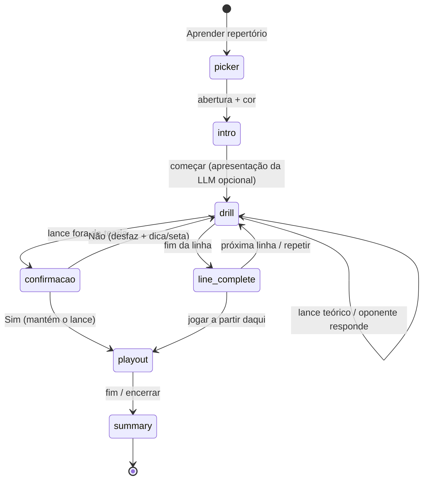

# 07 — Modo "Aprender repertório" (em desenvolvimento)

Plano aprovado e status da feature na branch `feat/learn-repertoire`. Atualize a tabela de status a cada fase concluída.

## Status

| Fase | Escopo | Status | Commit |
|---|---|---|---|
| 1 | Backend: catálogo e árvore de teoria | ✅ concluída | `a719b4c` |
| 2 | Frontend: botão na tela inicial, escolha do repertório, cliente de API tipado | ✅ concluída | `49cd306` |
| 3 | Drill no frontend (inclui confirmação ao sair da teoria) | ⏳ próxima | — |
| 4 | LLM: apresentação da abertura e "por que esse lance?" | pendente | — |
| 5 | Partida contra o Stockfish a partir da posição (playout) | pendente | — |
| 6 | Documentação final | pendente | — |

## Objetivo e decisões de produto

- **Fonte do repertório:** catálogo Lichess (`backend/data/openings.tsv`). Repertório próprio via PGN fica para depois.
- **Mecânica:** drill de linhas (o sistema joga as respostas teóricas, o jogador acerta os lances do repertório) e, ao fim da linha, partida contra o Stockfish a partir da posição.
- **Saída da teoria:** quando o jogador faz um lance fora da teoria, o sistema **pergunta primeiro** se o jogador quer sair da teoria. Sim → o lance é mantido e começa a partida contra o Stockfish dali. Não → o lance é desfeito e o sistema orienta como se manter na teoria (dica com destaque da peça; depois, seta com o lance principal).
- **Progresso:** sem persistência no MVP; o estado vale só para a sessão.
- **LLM:** apresenta a abertura antes do treino e explica qualquer lance da linha ("por que esse lance?"). Prompts novos em **português**.
- **Invariantes mantidas:** a teoria define o lance certo, o Stockfish dá os números, a LLM só explica; backend sem estado.

## Arquitetura

O backend entrega a árvore de teoria inteira numa requisição; o drill roda 100% no frontend (validar lance, escolher a resposta do oponente, detectar fim de linha). O backend só volta a ser chamado para LLM, avaliação do Stockfish e a fase de jogo.

## Fases

### Fase 1 — Backend: catálogo e árvore ✅

Ver [01-features.md F15](01-features.md) e a tabela da API em [02-arquitetura.md](02-arquitetura.md). Arquivos: `backend/services/repertoire_service.py`, `backend/services/openings_service.py` (índice com `lines`), rotas em `chess_trainer_system_server.py`, `backend/tests/test_repertoire.py`.

Diferenças em relação ao plano original: a lógica ficou num módulo próprio (`repertoire_service`) em vez de dentro do `openings_service`; a árvore é `GET /api/repertoire/tree?name=` sem `color` (a cor não muda a árvore, e o frontend decide o lado).

### Fase 2 — Frontend: entrada e escolha ✅

- `LandingPage.tsx`: terceiro botão **Aprender repertório**.
- `App.tsx`: telas `repertoire-picker` e `repertoire` na máquina de estados `screen`; estado `repertoire: RepertoireSelection` (`opening` + `color`). O `RepertoireTrainer` recebe `key` = nome + cor, então trocar a seleção reinicia a sessão.
- `RepertoirePicker.tsx`: busca por nome ou ECO, sem diferenciar acentos (`Grunfeld` acha `Grünfeld`). Famílias se expandem em variantes; durante a busca, as variantes que casam aparecem já abertas. Mostra a prévia do tabuleiro no fim da linha de referência, orientado pela cor, e a escolha de cor com a sugestão marcada. Estilos `.repertoire-*` em `index.css`, com layout de uma coluna abaixo de 780 px.
- `frontend/src/repertoire/api.ts`: cliente tipado (`fetchRepertoireCatalog`, `fetchRepertoireTree`) com tipos espelhando os DTOs do backend; propaga o `detail` dos erros HTTP.
- `RepertoireTrainer.tsx`: **por enquanto só carrega a árvore** e mostra o tabuleiro inicial e um resumo (linhas e lances). A Fase 3 constrói o drill nesta tela.

Diferença em relação ao plano original: o cliente de API ficou em `frontend/src/repertoire/api.ts` (pasta da feature, junto do futuro `drill.ts`), e não em `frontend/src/api/repertoire.ts`, para não criar uma pasta `api/` ao lado do arquivo `api.ts`.

### Fase 3 — Drill

- **Não** adicionar um terceiro modo ao `GameBoard.tsx` (débito C1).
- `frontend/src/repertoire/drill.ts` (novo, funções puras): `expectedMoves(node)` (qualquer filho teórico é acerto; o mais popular é a linha principal), `classifyUserMove(node, uci) → 'theory' | 'off-book'`, `pickOpponentMove(node, visited, rng)` (sorteio ponderado por popularidade, preferindo ramos não vistos), `isLineEnd(node)`, `nextUnvisitedLine(tree, visited)`.
- `RepertoireTrainer.tsx` (já existe, hoje só carrega a árvore): estados `intro → drill → line-complete → playout → summary`; modal de confirmação ao sair da teoria (reaproveita `Modal`); dica com `squareStyles` e depois seta com `arrows` do `react-chessboard`; opcionalmente mostra no modal a avaliação do Stockfish do lance jogado vs. o teórico (`/api/engine-analysis`); painel com o nome da variante atual e a lista de lances; resumo determinístico (linhas concluídas, acertos de primeira, lances com mais erros, ponto de saída da teoria).
- Mover `cloneGame` e `plyFromFen` de `GameBoard.tsx` para `frontend/src/chess/utils.ts`.

### Fase 4 — LLM

- `POST /api/repertoire/intro` → `generate_opening_intro` em `llm_service.py`. Dados: ECO, nome, cor do aluno, linha de referência, 3–5 variantes mais populares da árvore, avaliação do Stockfish da posição final da linha. Pede ideias, planos, estrutura de peões, armadilhas.
- `POST /api/repertoire/explain-move` → `generate_theory_move_explanation`. Dados: linha até o lance, o lance, alternativas teóricas naquele ponto, nome da variante e `get_move_analysis(fen, move)` formatado com `format_analysis_block`.
- Padrão de `generate_move_evaluation` → `complete_prompt` (BYOK + somente prompt); erros 400/502/500. Testes com `provider: "prompt"`.

### Fase 5 — Playout

- Entrada pelo fim da linha ou pela saída da teoria confirmada.
- Alterna o usuário com `POST /api/engine-move` (`training: true`); classifica os lances do usuário em segundo plano com `/api/engine-analysis` (*fire-and-track*, como no `GameBoard`). Ao encerrar: resultado e precisão média. Integração com `/api/game-stats` fica para depois.

### Fase 6 — Documentação

Seguir [06-guia-para-ia.md §6.7](06-guia-para-ia.md), mover a feature de "em desenvolvimento" para estável e atualizar o `CLAUDE.md`.

## Fora do MVP

- Persistência e repetição espaçada (localStorage, depois backend).
- Repertório próprio via PGN com variantes (mesmo formato de árvore).
- Explicação da LLM ao errar e relatório da sessão pela LLM.
- Cache por FEN das análises do Stockfish (débito P2).

## Verificação ao final

1. `cd backend && python -m pytest tests -q`.
2. Swagger: `catalog`, `tree` (Najdorf), `intro` e `explain-move` com `provider=prompt`.
3. `cd frontend && yarn lint && yarn build`.
4. Manual: Najdorf de pretas (drill, variedade do oponente, "por que esse lance?", saída da teoria com Não e com Sim), Ruy Lopez de brancas (orientação, quem joga primeiro) e regressão de Novo jogo e Carregar PGN.
