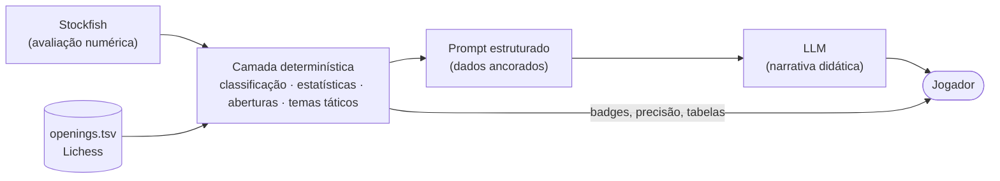

# Documentação — Chess Trainer System

Documentação técnica do estado atual do projeto, extraída diretamente da leitura do código. Serve como base comum para o time e como contexto para sessões futuras com assistentes de IA (Claude ou outros).

| Sincronização | |
|---|---|
| Branch | `feat/learn-repertoire` (criada a partir da `develop`, que já contém a `feat/training-game`) |
| Último commit coberto | `7bcd979` — *feat: play on against Stockfish when the repertoire line ends* |
| Data | 2026-11-11 |
| Alterações não commitadas consideradas | nenhuma |
| Trabalho em andamento | Modo **Aprender repertório** — Fases 1, 2, 3 e 5 de 6 concluídas (a 5 foi adiantada); falta a 4 (LLM); ver [07-modo-repertorio.md](07-modo-repertorio.md) |

Para saber o que mudou no código desde esta documentação: `git log --oneline 7bcd979..HEAD` e `git diff 7bcd979 HEAD --stat`.

## Princípio central

> **O Stockfish é a fonte da verdade; a LLM é o professor que traduz.**

Toda afirmação que chega ao jogador nasce de um dado concreto calculado de forma determinística (avaliação do Stockfish, probabilidade de vitória, heurísticas táticas do `python-chess`, base de aberturas do Lichess). A LLM recebe esses dados já prontos em um prompt estruturado e tem a única função de explicá-los de forma didática. Ela nunca é a responsável por decidir se um lance é bom ou ruim.

## Índice

| Documento | Conteúdo |
|---|---|
| [01-features.md](01-features.md) | Catálogo de funcionalidades extraídas do código, com regras e parâmetros |
| [02-arquitetura.md](02-arquitetura.md) | Visão de contexto, containers, componentes, contratos da API e modelo de dados |
| [03-fluxos.md](03-fluxos.md) | Diagramas de sequência e de estados dos fluxos principais |
| [04-design-patterns.md](04-design-patterns.md) | Padrões de projeto e arquiteturais identificados (backend e frontend) |
| [05-observacoes-tecnicas.md](05-observacoes-tecnicas.md) | Débitos técnicos, inconsistências e pontos de atenção antes de evoluir |
| [arquitetura.html](arquitetura.html) | Versão visual (abre no navegador) com todos os diagramas renderizados |
| [06-guia-para-ia.md](06-guia-para-ia.md) | Contexto condensado, invariantes e convenções para assistentes de IA trabalharem no projeto |
| [07-modo-repertorio.md](07-modo-repertorio.md) | Plano e status do modo "Aprender repertório" (feature em desenvolvimento) |
| [CHANGELOG.md](CHANGELOG.md) | Registro de cada sincronização da documentação com o código |

Os diagramas estão em [Mermaid](https://mermaid.js.org/): renderizam no GitHub, no VS Code (extensão *Markdown Preview Mermaid Support*) e no [arquitetura.html](arquitetura.html).

## Resumo em uma página

| Camada | Tecnologia | Responsabilidade |
|---|---|---|
| Frontend (SPA) | React 19 + TypeScript + Vite, `chess.js`, `react-chessboard`, `react-markdown` | Tabuleiro interativo, validação local de lances, orquestração das chamadas, exibição do relatório |
| API | FastAPI + Pydantic (`backend/chess_trainer_system_server.py`) | 8 endpoints REST, contratos de entrada/saída, tradução de erros em HTTP, pré-carga das aberturas na inicialização |
| Serviços | Python (`backend/services/`) | `engine_service` (Stockfish), `report_service` (estatísticas + prompt do relatório), `openings_service` (teoria), `repertoire_service` (catálogo e árvore de repertório), `llm_service` (provedores LLM) |
| Motor | Stockfish via protocolo UCI (`python-chess`) | Jogar e avaliar posições (profundidade 20) |
| LLM | Qualquer API compatível com OpenAI (Gemini configurado por padrão) — chave do próprio usuário (BYOK) | Explicação de lance e relatório pós-partida |
| Dados | `backend/data/openings.tsv` (Lichess chess-openings, CC0) | Identificação de abertura e desvio da teoria |

Pontos de entrada:

- **Novo jogo** → partida de treino contra o Stockfish, todos os lances analisados durante o jogo mas com feedback oculto até o fim → estatísticas imediatas + narrativa do treinador.
- **Carregar PGN** → importação de partida → análise automática de todos os lances → relatório.
- **Aprender repertório** *(em desenvolvimento)* → escolher abertura/defesa do catálogo Lichess → drill das linhas teóricas → partida contra o Stockfish a partir da posição. Hoje funcionam a escolha da abertura, o drill (com confirmação ao sair da teoria), a partida contra o Stockfish depois da teoria e o resumo; falta a LLM.
- **CLI** (`backend/chess_trainer_system_cli.py`) → avaliação de um lance (FEN + UCI) via API, interativa ou por arquivos.
